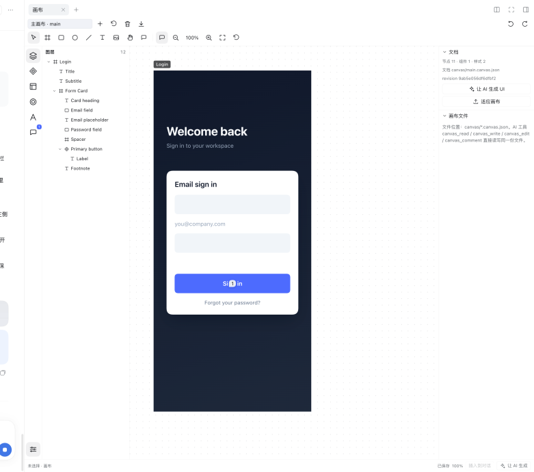
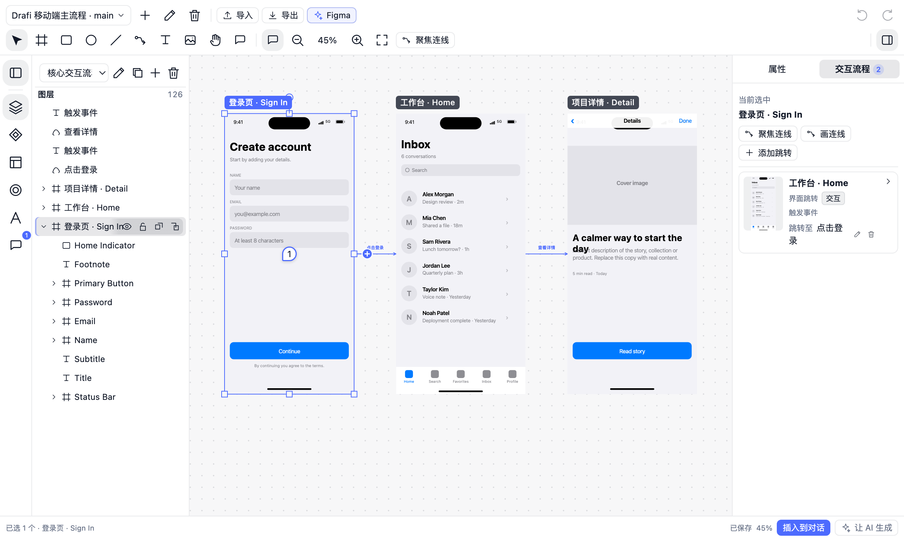
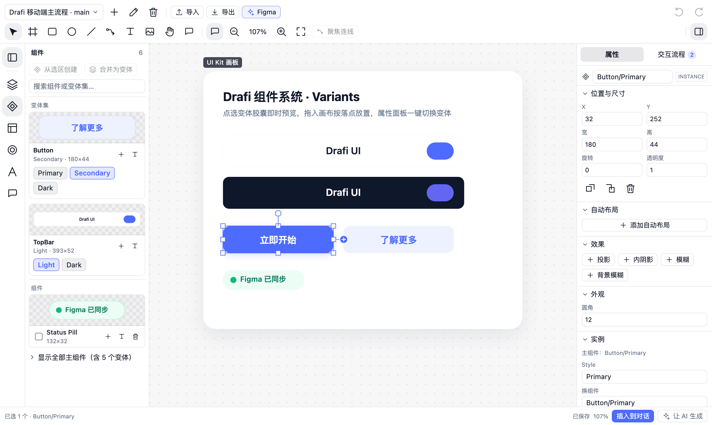
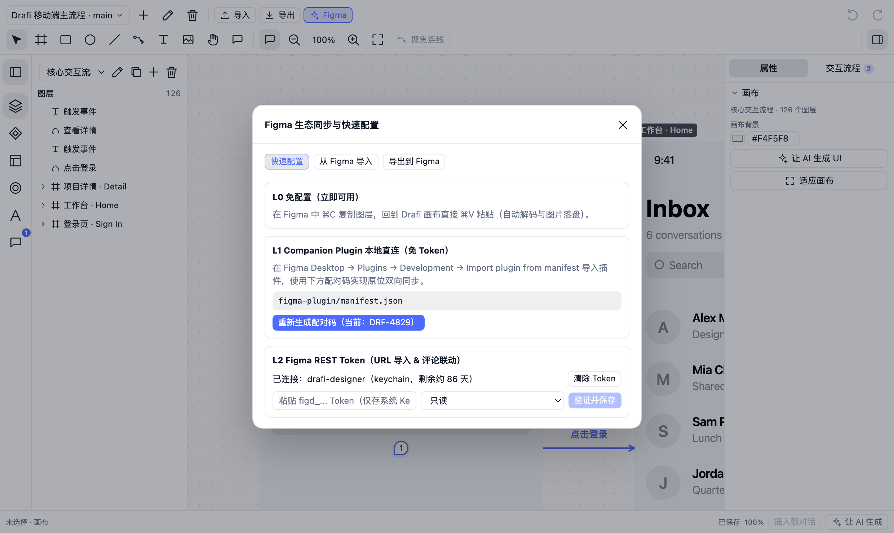

# Drafi


**An AI-native design canvas for [DeepSeek Harness (DSH)](https://github.com/deepseek-ai/deepseek-harness).**

Design UI mockups visually in the right sidebar, reference any canvas selection in chat with one click, and let agents generate, edit, audit, and visually inspect designs through an open JSON file (`dsh.canvas@1`).

**English** · [简体中文](README.zh.md)

[](https://github.com/aiShuiJiaoDeXioShou/dsh-canvas/actions/workflows/ci.yml)
[](LICENSE)
[](FORMAT.md)
[](https://github.com/deepseek-ai/deepseek-harness)

[Features](#features) · [Quick Start](#quick-start) · [How It Works](#how-it-works) · [Agent Tools](#agent-tools--runtime-skill) · [Design Systems](#design-systems--templates) · [Workspace & Format](#workspace-storage--open-format) · [Development](#development)

<br clear="right" />

<table align="center">
  <tr>
    <td align="center" valign="bottom">
      
      <br />
      <sub><b>Drafi inside DSH</b> — layers, infinite canvas, inspector, and pinned comments</sub>
    </td>
    <td align="center" valign="bottom">
      
      <br />
      <sub><b>Mobile UI output</b> — iPhone 16 screen rendered & exported from Drafi</sub>
    </td>
  </tr>
</table>

### Feature Highlights

<table align="center">
  <tr>
    <td align="center" valign="top" colspan="2">
      
      <br />
      <sub><b>Interactive Flow Connectors & Multi-Canvas</b> — drag connectors via the toolbar tool (<code>K</code>) or the blue <code>+</code> quick-connect handle, auto-route arrows when screens move, and jump/edit/focus transitions from the always-on Flow panel</sub>
    </td>
  </tr>
  <tr>
    <td align="center" valign="top" width="50%">
      
      <br />
      <sub><b>Live Variant Previews & Direct Manipulation</b> — click variant chips to switch live SVG previews without accidental inserts, drag onto the canvas at the cursor, and swap variants in the inspector</sub>
    </td>
    <td align="center" valign="top" width="50%">
      
      <br />
      <sub><b>Figma Ecosystem Sync & Zero-Leak Setup</b> — L0 clipboard paste, L1 free Companion Plugin local pairing, L2 Keychain-backed REST sync, 3-way Pull/Push diffs, and lossless <code>.dshfig</code> bundles</sub>
    </td>
  </tr>
</table>

---

## Features

### Visual Canvas Editor
- **Infinite Workspace** — pan/zoom canvas with a neutral Figma-style dotted grid, top-level frame labels (click a label to select its frame), smart snapping, distance measurement (`⌥/Alt + hover`), alignment, grouping, z-order, lock/hide, and full undo/redo.
- **Rich Node Primitives** — `frame`, `group`, `rect`, `ellipse`, `line`, `text`, SVG `path` (with basic SVG `<path>` toolbar import), and component `instance`.
- **Auto-Layout & Responsive Sizing** — horizontal/vertical flex frames with gap, padding, primary/counter alignment, `fixed` / `hug` / `fill` child sizing, nested auto-layout, and text auto-height.
- **Components, Variants & Local Styles** — convert selections into reusable components, insert instances, override text/fills/visibility, swap variants, edit main components in isolation, and manage live-propagating fill, text, and effect styles.
- **Fills, Effects, Fonts & Cropping** — stacked fills (solid, linear/radial gradient, image), drop/inner shadows, layer blur and background blur, non-destructive image cropping, and custom font uploads (`woff2` / `woff` / `ttf` / `otf`) registered via `@font-face` and embedded in exports.
- **Focused Chrome** — collapsible left drawer (layers, components, templates, styles, fonts, comments) and right inspector, modal create/rename/export dialogs, and full context menus on both canvas and layer tree.

### Bidirectional AI Co-Design
- **One-Click Selection to Chat** — insert the active canvas selection into the composer as a compact link (`[画布选区：Title](dsh-canvas://main?node=title)`). A locate chip (`在画布中定位：Title`) stays pinned above the composer, and sent messages render as clickable canvas chips that open Drafi and zoom straight to the node.
- **Live Sync Under 1 Second** — agent edits stream to open canvas tabs over SSE (with polling fallback) and revision guards prevent silent overwrites.
- **Token-Efficient Inspection** — `canvas_read` returns compact JSON with `query` search, `fields` projection, `depth` / `childrenLimit` controls, and the user's live canvas selection.
- **Visual Self-Verification** — `canvas_snapshot` renders the whole page or any node directly from the open canvas tab to PNG so the agent can visually inspect its own work instead of guessing from JSON.
- **Threaded Design Comments** — pin single-user comment threads to nodes or page positions; agents can list, add, reply, and resolve threads via `canvas_comment`.

### Design Systems, Templates & Quality
- **`canvas-ui-design` Runtime Skill** — guides agents through requirements clarification, screen/component generation, reference rebuilds, refactoring, design reviews, and handoff.
- **Built-in Design Foundations** — Material Design 3 tokens for general UI and Apple HIG metrics/colors for iOS, paired with four density/geometry presets (`Neutral`, `Minimal`, `Soft`, `Compact`) and iPhone 16 (`393×852`, default) / iPhone 15 (`390×844`) templates.
- **Deterministic Design Audit** — `canvas_audit` checks screenshot boundaries, text contrast, touch targets, clipped children, zero-size nodes, missing references, unresolved comments, and empty frames while explicitly reporting skipped checks.
- **CSS Handoff** — a collapsible **代码 (Code)** section in the inspector resolves layout, fills, gradients, borders, radii, shadows, and typography to copy-ready CSS.

### Local-First Storage, Figma Ecosystem & Portable Exports
- **Open JSON Format** — designs live as plain JSON in `<workspace>/.dsh-canvas/*.canvas.json` (`dsh.canvas@1`), editable by Drafi, agent tools, or ordinary file tools.
- **Free Figma Bidirectional Sync** — copy/paste directly from Figma (`⌘C` → `⌘V`), import `.fig` local copies or Figma URLs, run Git-like 3-way Pull/Push diffs (`in-place` or `proposal-frame`) via the free **Drafi Companion** Figma Plugin (`figma-plugin/`), sync Figma review comments into Drafi comments/TODOs, and exchange lossless `.dshfig` bundles. All Figma bindings and passthrough metadata stay isolated in `.dsh-canvas/figma/<name>.sync.json`.
- **`canvas-figma-setup` Quick Setup Skill** — guides users through 30-second zero-leak onboarding (progressive L0 clipboard → L1 Companion Plugin pairing → L2 Keychain-backed Figma REST Token via UI password box or `scripts/figma-setup.mjs --from-clipboard`).
- **Browser Save-Picker Export** — export the selection, frame, or page as PNG, SVG, `.dshfig`, or a portable `.drafi.json` pack directly to disk via the browser save picker (with download fallback), without polluting the workspace or chat composer.
- **Image Capability Chain** — `canvas_image` automatically probes native GPT/OpenAI image generation, falls back to a local Codex CLI (`image_generation`), or imports local image files into `.dsh-canvas/assets/`.

---

## How It Works

```text
  Right Sidebar ("Drafi")                 Chat Composer & Agent
  ┌───────────────────────────┐           ┌──────────────────────────────┐
  │ Visual Canvas Editor      │ ──chip──▶ │ dsh-canvas://main?node=...   │
  │ (React, zero npm deps)    │ ◀──SSE─── │ 13 canvas_* tools + 2 skills   │
  └─────────────┬─────────────┘           └──────────────┬───────────────┘
                │ loopback HTTP / SSE                    │ direct Host API
                ▼                                        ▼
        ┌────────────────────────────────────────────────────────┐
        │   DSH Host Plugin (@local/dsh-canvas)                  │
        │   Validation · Revision Guards · Assets · Fonts        │
        └───────────────────────────┬────────────────────────────┘
                                    ▼
                    <workspace>/.dsh-canvas/*.canvas.json
```

1. **Open Drafi** — click the **Drafi** guide card in the DSH right sidebar to open the canvas tab. *(The right sidebar is the sole entry point; if the sidebar slot is unavailable, Drafi falls back to an expandable inline dock above the composer.)*
2. **Generate or Sketch** — insert an iOS template from the Templates panel, sketch frames manually, or ask the agent in chat (e.g., *"Create an iPhone 16 onboarding screen in Drafi"*).
3. **Select & Iterate** — select layers on the canvas and click **Insert to chat** (status bar or right-click menu), or drop a comment pin (`C`) on a specific element. Ask the agent to refine copy, layout, contrast, or variants.
4. **Audit, Snapshot & Export** — the agent validates with `canvas_audit` and inspects rendered pixels with `canvas_snapshot`. Export finished screens as PNG, SVG, or a self-contained `.drafi.json` pack from the toolbar or context menu.

---

## Quick Start

### Prerequisites
- **[DeepSeek Harness (DSH)](https://github.com/deepseek-ai/deepseek-harness)** (Web or Desktop).
- **Node.js ≥ 22** and **pnpm ≥ 11** *(only needed if you modify and rebuild from source; prebuilt `client/client.js` and `dist/host/main.js` are committed in the repository)*.

### 1. Clone the repository

```bash
git clone https://github.com/aiShuiJiaoDeXioShou/dsh-canvas.git
cd dsh-canvas
```

*(Optional — run checks locally before installing:)*

```bash
pnpm install
pnpm check   # typecheck + build + test
```

### 2. Install into DeepSeek Harness

Choose whichever method fits your DSH workflow:

- **Via DSH `plugin_manager` (in-session):**
  ```text
  plugin_manager action=install_bundle target=/absolute/path/to/dsh-canvas
  ```
- **Via DSH CLI:**
  ```bash
  dsh plugin --profile <profile> add "link:$PWD"
  ```
- **Via Desktop/Web UI:** open **Settings → Plugins** and select the cloned `dsh-canvas` directory.

### 3. Reload

- Refresh the Harness page (or toggle the plugin) to pick up a rebuilt client bundle.
- Disable and re-enable the plugin (or restart DSH) to reload Host code changes.

> **Technical identifiers:** The brand name is **Drafi**, while the package name (`@local/dsh-canvas`), in-chat link scheme (`dsh-canvas://`), workspace directory (`.dsh-canvas/`), and document format (`dsh.canvas@1`) preserve their stable technical identifiers.

---

## Agent Tools & Runtime Skill

Drafi registers **13 tools** and two runtime skills (**`canvas-ui-design`** and **`canvas-figma-setup`**) inside the DSH Host:

| Tool | Purpose | Key Options / Actions |
| --- | --- | --- |
| `canvas_read` | Inspect a document, interactions, and current user selection in compact JSON | `detail`: `outline` \| `node` \| `full` \| `interactions`; `query`, `fields`, `depth`, `childrenLimit`, `offset` |
| `canvas_interaction_view` | Inspect or navigate interaction focus (`pageRef` & wires) in the live canvas | `action`: `status` \| `focus` \| `reveal` \| `return` \| `clear`; `nodeId` |
| `canvas_write` | Create or replace a full `dsh.canvas@1` document | `name`, `doc`, `baseRevision` |
| `canvas_edit` | Apply atomic edits with full-document validation | `ops`: `add`, `update`, `move`, `remove`, `set`, `comment.*`; `baseRevision` |
| `canvas_comment` | Manage single-user threaded feedback pinned to nodes or coordinates | `action`: `list` \| `add` \| `reply` \| `resolve` |
| `canvas_template` | Query design foundations, load style libraries, or insert templates | `action`: `list` \| `insert` \| `styles` \| `foundation`; `device`, `preset`, `system` |
| `canvas_audit` | Run deterministic read-only design checks | Checks boundaries, contrast, touch targets, clipping, zero-size, broken refs, empty frames |
| `canvas_image` | Resolve image generation or import local assets | `action`: `probe` \| `generate` \| `import` |
| `canvas_export` | Pack a document and all referenced assets into one portable file | Writes `.dsh-canvas/exports/<name>.drafi.json` |
| `canvas_import` | Restore a `.drafi.json` pack into a document plus assets | `path`, optional `name`, `baseRevision` |
| `canvas_figma` | Bidirectional Figma ecosystem sync, setup probe, comments, and `.dshfig` bundles | `action`: `setup_status` \| `pair_start` \| `import_url` \| `import_fig` \| `pull_diff` \| `push_diff` \| `sync_comments` \| `reply_comment` \| `export_bundle` \| `import_bundle` |
| `canvas_migrate` | Upgrade a stored document to the current format version | `name`, `dryRun` |
| `canvas_snapshot` | Render the page or a node in the open tab and save a PNG | `name`, optional `nodeId`, `scale` (`0.5`–`4`, default `2`) |

### `canvas-ui-design` & `canvas-figma-setup` Skills
Registered automatically from [`skills/canvas-ui-design/`](skills/canvas-ui-design/SKILL.md) (adapted from the BD Flutter Dev UI design suite; see [`SOURCE.md`](skills/canvas-ui-design/SOURCE.md)) and [`skills/canvas-figma-setup/`](skills/canvas-figma-setup/SKILL.md). `canvas-ui-design` routes UI generation, component building, reference rebuilds, refactoring, and reviews while keeping `.dsh-canvas/*.canvas.json` as the single source of truth. `canvas-figma-setup` provides zero-leak 30-second Figma onboarding (L0 clipboard → L1 Companion Plugin pairing → L2 Keychain-backed Figma REST Token via UI password box or `scripts/figma-setup.mjs --from-clipboard`).

### Image Generation Chain (`canvas_image`)
1. **Native GPT/OpenAI image tool** — if the active model supports native image generation, the agent generates natively and imports via `canvas_image { action: "import" }`.
2. **Local Codex CLI fallback** — if a local `codex` binary with `image_generation` is available (overridable via `DSH_CANVAS_CODEX_BIN`), `canvas_image { action: "generate" }` invokes it in an isolated temp directory and imports the output.
3. **Manual import** — otherwise, import any local PNG/JPEG/WebP/GIF directly from the canvas toolbar or via `canvas_image { action: "import" }`.

---

## Design Systems & Templates

When no design system is specified by the user or existing document, Drafi applies a clear default baseline:

| Context | Default Baseline | Details |
| --- | --- | --- |
| General UI | **Material Design 3** | Colors, type scale, spacing, radii, and elevation tokens |
| iOS / iPhone screens | **Apple HIG** | SF-like typography, system colors, safe-area bars |
| Mobile device frame | **iPhone 16 (`393×852`)** | `iphone15` (`390×844`) also supported |
| Density / geometry preset | **Neutral** | Also includes `Minimal`, `Soft`, and `Compact` |

- **Built-in templates** (accessible via the left rail **Templates** panel or `canvas_template`):
  - **Pages:** `ios-screen` (Settings), `ios-form-screen`, `ios-list-screen`, `ios-detail-screen`
  - **System bars:** `ios-status-bar`, `ios-status-bar-light`, `ios-nav-bar`, `ios-tab-bar`
- **Load as local styles:** open **Styles → 内置规范** (or call `canvas_template { action: "styles", system: "material3" | "ios" }`) to add reusable fill, text, and effect styles without restyling existing layers.
- Full token and template specification: **[DESIGN.md](DESIGN.md)**.

---

## Workspace Storage & Open Format

All design artifacts live inside a hidden directory in the active session workspace so they never clutter your project root:

```text
<workspace>/
└── .dsh-canvas/
    ├── main.canvas.json     # Default dsh.canvas@1 document (plain JSON)
    ├── <name>.canvas.json   # Additional canvas documents (lowercase slugs)
    ├── assets/              # Uploaded & imported images (png/jpeg/webp/gif)
    ├── fonts/               # Uploaded custom fonts (woff2/woff/ttf/otf)
    ├── figma/               # Figma sync sidecars (<name>.sync.json: binding, 3-way base, passthrough, comments)
    ├── exports/             # Agent snapshots (PNG) & portable bundles (.dshfig / .drafi.json)
    ├── FORMAT.md            # Format reference (auto-generated on first open)
    └── DESIGN.md            # Default design system & templates (auto-generated)
```

- **Legacy migration:** Pre-0.3 workspaces that stored files in a visible `canvas/` directory are automatically renamed to `.dsh-canvas/` on first access. If both exist, `.dsh-canvas/` takes precedence.
- **Open schema:** Document structure, all 8 node types (`frame`, `group`, `rect`, `ellipse`, `line`, `text`, `path`, `instance`), auto-layout, variants, styles, comments, and validation rules are documented in **[FORMAT.md](FORMAT.md)** and **[schema/canvas.v1.schema.json](schema/canvas.v1.schema.json)**. See [`examples/login.canvas.json`](examples/login.canvas.json) for a sample document.

---

## Keyboard Shortcuts

<details>
<summary><b>Click to expand Figma-style shortcuts</b></summary>

#### Tools
| Shortcut | Action |
| --- | --- |
| `V` / `F` / `R` / `O` / `L` | Move/Select · Frame · Rectangle · Ellipse · Line |
| `T` / `I` / `H` / `C` | Text · Insert Image · Hand (Pan) · Comment |

#### Viewport & Zoom
| Shortcut | Action |
| --- | --- |
| `Space + Drag` / Mouse wheel | Pan canvas / Zoom |
| `⌘/Ctrl + +` / `⌘/Ctrl + -` | Zoom in / Zoom out |
| `⌘/Ctrl + 0` or `Shift + 0` | Reset zoom to 100% |
| `1` or `Shift + 1` | Zoom to fit all |
| `2` or `Shift + 2` | Zoom to selection |

#### Selection & Editing
| Shortcut | Action |
| --- | --- |
| `⌘/Ctrl + Z` / `⇧⌘Z` | Undo / Redo |
| `⌘/Ctrl + C` / `X` / `V` / `D` | Copy / Cut / Paste / Duplicate |
| `⌘/Ctrl + A` / `Delete` | Select all / Delete selection |
| `Arrow` / `Shift + Arrow` | Nudge 1 px / 10 px |
| `Enter` / `Esc` | Enter frame/group children / Cancel or deselect |
| `⌥/Alt + Hover` | Measure spacing to adjacent elements |

#### Hierarchy, Layout & Components
| Shortcut | Action |
| --- | --- |
| `⌘/Ctrl + G` / `⇧⌘G` | Group / Ungroup |
| `⌘/Ctrl + ]` / `[` | Bring forward / Send backward |
| `⇧⌘]` / `⇧⌘[` | Bring to front / Send to back |
| `Shift + A` | Add Auto-Layout to selected frame or group |
| `⌥⌘K` / `Ctrl + Alt + K` | Create component from selection |
| `⇧⌘L` / `⇧⌘H` | Lock/Unlock · Hide/Show selection |

</details>

---

## Architecture & Privacy

- **Local-first, zero external backend:** The Host half runs directly inside the DSH Node process and only reads/writes `<workspace>/.dsh-canvas/`. There is no cloud account, standalone daemon, or telemetry.
- **Loopback-only Host routes:** `/dsh-canvas/health` and `/dsh-canvas/api/*` enforce DSH connection checks and loopback same-origin validation.
- **Zero client runtime dependencies:** The browser bundle (`client/client.js`) ships no runtime npm packages—React and `react/jsx-runtime` are provided by the DSH host shell.
- **Strict Host/Client boundaries:** Browser code never imports `node:*` or Host modules; Host code never imports React or DOM APIs; pure document logic is shared via `src/shared/`.

---

## Development

```bash
pnpm install        # Install dev dependencies (TypeScript, esbuild, tsx)
pnpm typecheck      # Run TypeScript checks across path, host, client & tests
pnpm build          # Bundle client/client.js and dist/host/main.js via esbuild
pnpm test           # Run Node test suite (tsx --test tests/*.test.ts)
pnpm check          # Run typecheck + build + test
```

> Tip: Set `DSH_CANVAS_PRETTY_JSON=1` to pretty-print agent tool responses when debugging.

### Repository Layout

| Path | Role |
| --- | --- |
| `index.js` | Thin DSH Host entry with cache-busted import of `dist/host/main.js` |
| `src/shared/format.ts` | `dsh.canvas@1` document model, normalization, validation, and migration |
| `src/shared/ops.ts` | Pure document mutations shared by agent tools and UI |
| `src/shared/path/` | Strict SVG path parser, bounds/viewBox calculator, and basic SVG importer |
| `src/shared/design-system.ts` | Material Design 3 & Apple HIG tokens and style library generators |
| `src/shared/foundation.ts` | Device metrics (iPhone 16 / 15) and style presets |
| `src/shared/templates.ts` | Device-aware iOS screen and system-bar template builders |
| `src/shared/audit.ts` | Deterministic design audit engine |
| `src/host/main.ts` | Host HTTP routes, SSE stream, file store, assets/fonts, and 13 agent tools |
| `src/host/image.ts` | Image capability probe, Codex CLI adapter, and safe asset import |
| `src/host/skills.ts` | Registers the `canvas-ui-design` runtime skill |
| `src/client/index.tsx` | Right sidebar tab registration, inline-dock fallback, composer locate chip & chat link renderer |
| `src/client/store.ts` | Canvas tab state store, undo/redo history, autosave, and SSE/polling sync |
| `src/client/editor/` | Layout engine, DOM renderer, hit testing, geometry, text measure, PNG/SVG export |
| `src/client/ui/` | Toolbar, layer tree, inspector, panels, icons, tooltips, and context menus |
| `skills/canvas-ui-design/` | Runtime UI design skill, workflows, presets, and references |
| `schema/` | JSON Schema for `dsh.canvas@1` |
| `tests/` | Unit, layout, audit, icon, UI, and Host tool integration tests |

For architectural invariants, TypeScript guidelines, and release rules, see **[AGENTS.md](AGENTS.md)**. Generated bundles (`client/client.js`, `dist/host/main.js`) must be rebuilt and committed with source changes.

---

## Known Limitations (v1)

- **Local-first collaboration:** No realtime multiplayer cursors inside Drafi itself (use Figma as the team review hub via `canvas_figma` and the free Companion Plugin). Multi-page switching is supported via the Layers panel page switcher.
- **Browser-side rendering:** No headless server-side renderer, thumbnailer, or font subsetter. `canvas_snapshot` renders inside the open browser tab and therefore requires the Drafi tab to be open.
- **Export approximations:** Background blur is exact on screen (`backdrop-filter`) but approximated in SVG/PNG exports.
- **Composer link behavior:** Because the composer accepts plain text, inserted selections appear as markdown links in the input box and convert to clickable reference chips once sent.
- **Vector & prototyping scope:** Figma clipboard (`⌘C/⌘V`), `.fig` import, free REST API URL/comments sync, and Companion Plugin patches are supported; Penpot import, pen/bezier anchor editing, and runtime prototyping playback are not included. Basic SVG `<path>` import is supported; unsupported elements (transforms, text, filters, masks) are skipped with warnings. Path hit-testing currently uses the node bounding box.
- **Auto-layout & overrides:** Supports `cornerRadii`, `layoutPositioning: 'absolute'`, `layout.wrap`, and `layout.ignoreHidden`, while CSS grid and min/max constraints remain passthrough-only. Component instance overrides support text, fills, and visibility (plus root `cornerRadius`), not inner-node layout overrides.
- **Image generation:** Requires either a GPT/OpenAI model with native image generation or a local Codex CLI with `image_generation`; otherwise import images manually.

---

## Artwork, Credits & License

- **License:** MIT — see [LICENSE](LICENSE).
- **Mascot artwork:** [`icon.png`](icon.png) contains the AI-generated Drafi mascot artwork embedded directly in the browser bundle; [`icon.svg`](icon.svg) wraps the same PNG for package icon export (full-resolution source in [`docs/drafi-icon.png`](docs/drafi-icon.png)). The artwork combines the Figma mark with a whale-maid character inspired by the [community DeepSeek mascot](https://github.com/yanzwzz/dsh-whale-girl-pet).
- **UI design skill:** Adapted from `blockdancez/bd-flutter-dev`; see [`skills/canvas-ui-design/SOURCE.md`](skills/canvas-ui-design/SOURCE.md).
- **Trademark notice:** Drafi is an independent open-source plugin and is not an official Figma product. The repository's MIT license applies to its code and does not grant rights to third-party trademarks or character designs.
