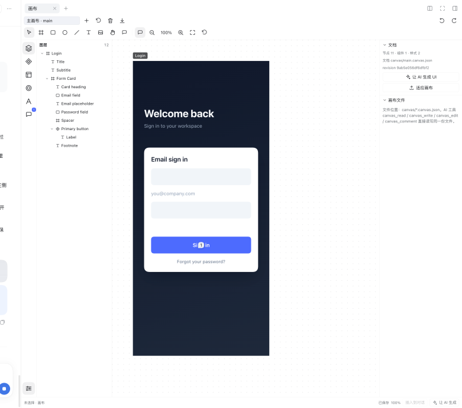

# Drafi


**面向 [DeepSeek Harness (DSH)](https://github.com/deepseek-ai/deepseek-harness) 的 AI 原生设计画布插件。**

在右侧边栏可视化编辑 UI 设计稿，一键将画布选区插入对话，让 Agent 通过开放的 JSON 文档（`dsh.canvas@1`）实时生成、修改、审查并截图核对设计效果。

[English](README.md) · **简体中文**

[](https://github.com/aiShuiJiaoDeXioShou/dsh-canvas/actions/workflows/ci.yml)
[](LICENSE)
[](FORMAT.md)
[](https://github.com/deepseek-ai/deepseek-harness)

[核心特性](#核心特性) · [快速开始](#快速开始) · [工作原理](#工作原理) · [Agent 工具与技能](#agent-工具与运行时技能) · [设计规范与模板](#设计规范与内置模板) · [工作区存储](#工作区存储与开放格式) · [本地开发](#本地开发)

<br clear="right" />

<table align="center">
  <tr>
    <td align="center" valign="bottom">
      
      <br />
      <sub><b>DSH 中的 Drafi</b> — 图层树、无限画布、属性面板与节点评论</sub>
    </td>
    <td align="center" valign="bottom">
      
      <br />
      <sub><b>移动端设计输出</b> — 在 Drafi 中生成并导出的 iPhone 16 页面</sub>
    </td>
  </tr>
</table>

---

## 核心特性

### 可视化设计画布
- **无限画布与流畅交互**：中性点阵背景、平移/缩放、顶层 Frame 标签（类 Figma，点击标签即可选中对应画板）、智能吸附、`⌥/Alt` 悬停测距、对齐分布、编组、层级排序、锁定/隐藏以及完整撤销重做。
- **丰富的图元节点**：支持 `frame`、`group`、`rect`、`ellipse`、`line`、`text`、SVG `path`（支持工具栏基础 SVG `<path>` 导入）以及组件 `instance`。
- **自动布局（Auto-Layout）**：支持水平/垂直排布、间距、内边距、主轴/交叉轴对齐、子节点 `fixed` / `hug` / `fill` 尺寸模式、嵌套自动布局与文本自适应高度。
- **组件、变体与本地样式库**：从选区一键创建组件、插入实例、覆盖文本/填充/可见性、切换变体、独立编辑主组件；支持填充/文本/效果样式库并实时同步到所有引用节点。
- **多重填充、特效、字体与裁切**：支持纯色/线性渐变/径向渐变/图片多重填充，投影/内阴影、图层模糊与背景模糊，非破坏性图片裁切，以及自定义字体上传（`woff2` / `woff` / `ttf` / `otf`），自动注册 `@font-face` 并在导出时内嵌。
- **克制聚焦的界面**：可折叠的左侧抽屉（图层、组件、模板、样式、字体、评论）与右侧属性面板、模态新建/重命名/导出弹窗，以及画布与图层树完整右键菜单。

### 双向 AI 协同设计
- **选区一键插入对话**：点击状态栏或右键菜单「插入到对话」，输入框写入紧凑的画布链接（`[画布选区：Title](dsh-canvas://main?node=title)`），输入框上方常驻「在画布中定位：Title」快捷定位条；发送后消息自动渲染为可点击的画布卡片，一点即可打开并定位到对应节点。
- **秒级实时同步**：Agent 修改文档后通过 SSE（附轮询兜底）在 1 秒内刷新打开的画布标签，并配有 `baseRevision` 冲突守卫防止覆盖并发改动。
- **低上下文开销读取**：`canvas_read` 默认输出紧凑 JSON，支持 `query` 关键词检索、`fields` 字段裁剪、`depth` / `childrenLimit` 深度控制，同时返回用户当前选区。
- **真实视觉自检闭环**：`canvas_snapshot` 直接让打开的画布标签将整页或指定节点渲染为 PNG，Agent 可读图核对实际观感，而不必凭 JSON 盲猜。
- **节点评论协作**：支持在节点或画布坐标上添加单人主题评论；Agent 可通过 `canvas_comment` 查看、回复和标记解决。

### 设计规范、模板与质量检查
- **`canvas-ui-design` 运行时技能**：内置完整 UI/UX 设计工作流，涵盖需求澄清、页面/组件生成、参考图还原、局部改稿、设计审查与开发交付。
- **内置默认设计系统**：通用界面默认遵循 **Material Design 3**，iOS 界面默认遵循 **Apple HIG**；内置 `Neutral` / `Minimal` / `Soft` / `Compact` 四套密度几何预设，以及 iPhone 16（`393×852`，默认）/ iPhone 15（`390×844`）页面与系统栏模板。
- **确定性设计审查**：`canvas_audit` 自动检查画板边界、文字对比度、触控目标尺寸、子节点裁切、零尺寸节点、失效引用、未解决评论与空画板，并明确列出跳过的检查项。
- **CSS 交付检查器**：右侧属性面板内置可折叠的「代码」区块，自动解析布局、填充/渐变、圆角、边框、阴影与排版 CSS，支持一键复制。

### 本地优先、Figma 生态与便携分享
- **开放 JSON 文档格式**：所有设计稿以纯 JSON 存放在 `<workspace>/.dsh-canvas/*.canvas.json`（`dsh.canvas@1`），既可由画布和专属工具编辑，也可由普通文件工具直接读写。
- **免费 Figma 生态双向同步**：支持 Figma `⌘C` → Drafi `⌘V` 剪贴板直粘、`.fig` 本地副本与 Figma URL 导入、通过免费 **Drafi Companion** Figma 插件（`figma-plugin/`）做类 Git Diff 的原位/对比画板双向同步、团队评论联动，以及 `.dshfig` 无损便携包；所有绑定与透传元数据隔离保存在 `.dsh-canvas/figma/<name>.sync.json`。
- **`canvas-figma-setup` 快速接入技能**：按 L0（免 Token 剪贴板）→ L1（免 Token 插件配对）→ L2（Keychain 安全存储 REST Token，支持 UI 密码框或 `scripts/figma-setup.mjs --from-clipboard` 盲存并清空剪贴板）30 秒零泄露引导配置。
- **浏览器保存弹窗导出**：支持将选区、画板或整页导出为 PNG、SVG、`.dshfig` 或便携包 `.drafi.json`，通过浏览器文件保存对话框直存本地（附下载兜底），不污染工作区或输入框。
- **图片能力链**：`canvas_image` 自动探测当前模型是否支持原生生图（GPT/OpenAI），不可用时回退至本机 Codex CLI（`image_generation`），或直接导入本地图片到 `.dsh-canvas/assets/`。

---

## 工作原理

```text
  右侧边栏（"Drafi" 标签）                  对话输入框与 Agent
  ┌───────────────────────────┐           ┌──────────────────────────────┐
  │ 可视化画布编辑器            │ ──选区──▶ │ dsh-canvas://main?node=...   │
  │ (React，无运行时 npm 依赖) │ ◀──SSE─── │ 13 个 canvas_* 工具 + 2 Skill │
  └─────────────┬─────────────┘           └──────────────┬───────────────┘
                │ 本机回环 HTTP / SSE                     │ Host 内部调用
                ▼                                        ▼
        ┌────────────────────────────────────────────────────────┐
        │   DSH Host 插件 (@local/dsh-canvas)                    │
        │   格式校验 · Revision 冲突守卫 · 图片/字体资源服务        │
        └───────────────────────────┬────────────────────────────┘
                                    ▼
                    <workspace>/.dsh-canvas/*.canvas.json
```

1. **打开 Drafi**：点击 DSH 右侧边栏引导卡片 **Drafi** 打开画布标签。*（右侧边栏为唯一入口，输入框工具栏不重复放置按钮；当右侧边栏扩展位不可用时，会自动回退到输入框上方的可展开内联面板。）*
2. **起稿或让 AI 生成**：从左侧「模板」面板插入 iOS 页面骨架，手动绘制图形，或在对话中直接让 Agent 生成（例如：*「在 Drafi 中设计一个 iPhone 16 设置页」*）。
3. **选区定向迭代**：选中画布元素后点击底部状态栏或右键菜单的「插入到对话」，或按 `C` 在节点上留下评论，让 Agent 定向调整布局、文案、配色或组件变体。
4. **审查、截图与导出**：Agent 通过 `canvas_audit` 做结构检查、用 `canvas_snapshot` 读回渲染图自检；定稿后从顶部工具栏或右键菜单导出 PNG、SVG 或 `.drafi.json` 便携包。

---

## 快速开始

### 环境要求
- **[DeepSeek Harness (DSH)](https://github.com/deepseek-ai/deepseek-harness)**（Web 或 Desktop）。
- **Node.js ≥ 22** 与 **pnpm ≥ 11** *（仅从源码二次开发和构建时需要；仓库已提交构建产物 `client/client.js` 与 `dist/host/main.js`，克隆后可直接安装）*。

### 1. 克隆仓库

```bash
git clone https://github.com/aiShuiJiaoDeXioShou/dsh-canvas.git
cd dsh-canvas
```

*（可选：本地校验构建与测试）*

```bash
pnpm install
pnpm check   # typecheck + build + test
```

### 2. 安装到 DeepSeek Harness

按你的使用习惯任选其一：

- **方式 A — 在 DSH 会话中使用 `plugin_manager`：**
  ```text
  plugin_manager action=install_bundle target=/absolute/path/to/dsh-canvas
  ```
- **方式 B — 使用 DSH CLI：**
  ```bash
  dsh plugin --profile <profile> add "link:$PWD"
  ```
- **方式 C — 通过插件管理页：** 打开 **Settings → Plugins**，选择本地 `dsh-canvas` 目录安装。

### 3. 生效与重载

- 修改并重新构建客户端后，刷新 Harness 页面（或开关插件）即可加载新的客户端 bundle。
- 修改 Host 代码后，禁用再重新启用插件（或重启 DSH）即可重载。

> **技术标识说明**：产品展示名为 **Drafi**；包名（`@local/dsh-canvas`）、对话内链接协议（`dsh-canvas://`）、工作区目录（`.dsh-canvas/`）以及文档格式标识（`dsh.canvas@1`）保持稳定的技术命名不变。

---

## Agent 工具与运行时技能

Drafi 在 DSH Host 中注册了 **13 个 Agent 工具**与 **`canvas-ui-design` / `canvas-figma-setup`** 两个运行时技能：

| 工具 | 作用 | 常用参数 / 动作 |
| --- | --- | --- |
| `canvas_read` | 以紧凑 JSON 读取画布文档、交互连线与用户当前选区 | `detail`: `outline` \| `node` \| `full` \| `interactions`；支持 `query`、`fields`、`depth`、`childrenLimit`、`offset` |
| `canvas_interaction_view` | 在实时画布中查看或导航 `pageRef` 与连线聚焦视图 | `action`: `status` \| `focus` \| `reveal` \| `return` \| `clear`；`nodeId` |
| `canvas_write` | 创建或整份替换 `dsh.canvas@1` 文档 | `name`、`doc`、`baseRevision` |
| `canvas_edit` | 批量原子编辑，写前校验整份文档 | `ops`: `add` / `update` / `move` / `remove` / `set` / `comment.*`；`baseRevision` |
| `canvas_comment` | 读写锚定在节点或画布坐标上的评论线程 | `action`: `list` \| `add` \| `reply` \| `resolve` |
| `canvas_template` | 查询设计基线、加载内置样式库或插入模板 | `action`: `list` \| `insert` \| `styles` \| `foundation`；`device`、`preset`、`system` |
| `canvas_audit` | 只读确定性设计审查 | 检查边界、对比度、触控目标、裁切、零尺寸、断链引用、空画板与未解决评论 |
| `canvas_image` | 探测生图能力、调用生图或导入本地图片素材 | `action`: `probe` \| `generate` \| `import` |
| `canvas_export` | 将文档及其引用的图片/字体打包为单文件 | 写入 `.dsh-canvas/exports/<name>.drafi.json` |
| `canvas_import` | 从 `.drafi.json` 便携包恢复文档与资源 | `path`、可选 `name`、`baseRevision` |
| `canvas_figma` | Figma 生态双向同步、配置体检、评论联动与 `.dshfig` 无损包 | `action`: `setup_status` \| `pair_start` \| `import_url` \| `import_fig` \| `pull_diff` \| `push_diff` \| `sync_comments` \| `reply_comment` \| `export_bundle` \| `import_bundle` |
| `canvas_migrate` | 将旧版本文档升级至当前格式并报告变更 | `name`、`dryRun` |
| `canvas_snapshot` | 在打开的画布标签中渲染整页或单节点为 PNG | `name`、可选 `nodeId`、`scale`（`0.5`–`4`，默认 `2`） |

### `canvas-ui-design` 与 `canvas-figma-setup` 运行时技能
由 Host 自动从 [`skills/canvas-ui-design/`](skills/canvas-ui-design/SKILL.md)（改编自 BD Flutter Dev UI 设计技能套件，见 [`SOURCE.md`](skills/canvas-ui-design/SOURCE.md)）与 [`skills/canvas-figma-setup/`](skills/canvas-figma-setup/SKILL.md) 注册。前者负责新建界面、补状态、建组件、按参考图还原、改稿与设计审查；后者提供 30 秒零泄露 Figma 快速接入（按需分档、Keychain 安全存 Token 与 Companion Plugin 配对）。

### 图片生成能力链（`canvas_image`）
1. **模型原生生图（GPT / OpenAI）**：若当前模型支持原生生图，直接生图后通过 `canvas_image { action: "import" }` 导入 `.dsh-canvas/assets/`。
2. **本机 Codex CLI 兜底**：若本机安装了支持 `image_generation` 的 `codex`（可通过环境变量 `DSH_CANVAS_CODEX_BIN` 指定路径），`canvas_image { action: "generate" }` 会在隔离临时目录中调用并导入产物。
3. **手动导入**：均不可用时，直接通过画布工具栏上传图片或调用 `canvas_image { action: "import" }` 导入本地 PNG / JPEG / WebP / GIF。

---

## 设计规范与内置模板

当用户未指定设计系统且文档尚无既有规范时，Drafi 自动采用以下默认基线：

| 场景 | 默认规范 | 说明 |
| --- | --- | --- |
| 通用 UI | **Material Design 3** | 颜色、字阶、间距、圆角与阴影层级 token |
| iOS / iPhone 页面 | **Apple HIG** | SF 风格排版、系统色与安全区栏位规范 |
| 默认移动设备画板 | **iPhone 16（`393×852`）** | 同时兼容 `iphone15`（`390×844`） |
| 密度与几何预设 | **Neutral** | 另提供 `Minimal`、`Soft`、`Compact` |

- **内置模板**（可在左侧「模板」面板或 `canvas_template` 中使用）：
  - **页面模板**：`ios-screen`（设置页）、`ios-form-screen`（表单页）、`ios-list-screen`（列表页）、`ios-detail-screen`（详情页）
  - **系统栏组件**：`ios-status-bar`、`ios-status-bar-light`、`ios-nav-bar`、`ios-tab-bar`
- **加载为本地样式库**：在「样式」面板点击「内置规范 → Material 3 / iOS HIG」（或调用 `canvas_template { action: "styles", system: "material3" | "ios" }`），即可将填充、文本、效果样式合并到当前文档，不会自动改写已有图层。
- 完整 token 与模板说明见 **[DESIGN.md](DESIGN.md)**。

---

## 工作区存储与开放格式

设计文件全部存放在当前会话工作区的隐藏目录下，不污染项目根目录：

```text
<workspace>/
└── .dsh-canvas/
    ├── main.canvas.json     # 默认 dsh.canvas@1 文档（纯 JSON）
    ├── <name>.canvas.json   # 其他画布文档（小写 slug 命名）
    ├── assets/              # 上传或导入的图片资源（png/jpeg/webp/gif）
    ├── fonts/               # 上传的自定义字体（woff2/woff/ttf/otf）
    ├── figma/               # Figma 同步侧车（<name>.sync.json：绑定、双基线、透传属性与评论）
    ├── exports/             # Agent 渲染截图（PNG）与便携包（.dshfig / .drafi.json）
    ├── FORMAT.md            # 格式参考手册（首次打开时自动生成）
    └── DESIGN.md            # 默认设计规范与模板说明（首次打开时自动生成）
```

- **旧目录自动迁移**：0.3 之前使用可见 `canvas/` 目录的工作区，在首次访问时会自动重命名为 `.dsh-canvas/`；若两个目录同时存在，以 `.dsh-canvas/` 为准。
- **开放 Schema**：文档结构、8 类节点（`frame` / `group` / `rect` / `ellipse` / `line` / `text` / `path` / `instance`）、自动布局、变体、样式、评论与校验规则详见 **[FORMAT.md](FORMAT.md)** 与 **[schema/canvas.v1.schema.json](schema/canvas.v1.schema.json)**，示例文档见 [`examples/login.canvas.json`](examples/login.canvas.json)。

---

## 快捷键

<details>
<summary><b>展开查看 Figma 风格快捷键</b></summary>

#### 工具切换
| 快捷键 | 功能 |
| --- | --- |
| `V` / `F` / `R` / `O` / `L` | 选择移动 · 画板 Frame · 矩形 · 椭圆 · 直线 |
| `T` / `I` / `H` / `C` | 文本 · 插入图片 · 抓手（平移） · 评论 |

#### 视口与缩放
| 快捷键 | 功能 |
| --- | --- |
| `Space + 拖拽` / 鼠标滚轮 | 平移画布 / 缩放视图 |
| `⌘/Ctrl + +` / `⌘/Ctrl + -` | 放大 / 缩小 |
| `⌘/Ctrl + 0` 或 `Shift + 0` | 重置为 100% |
| `1` 或 `Shift + 1` | 适应全部内容 |
| `2` 或 `Shift + 2` | 适应当前选区 |

#### 选区与编辑
| 快捷键 | 功能 |
| --- | --- |
| `⌘/Ctrl + Z` / `⇧⌘Z` | 撤销 / 重做 |
| `⌘/Ctrl + C` / `X` / `V` / `D` | 复制 / 剪切 / 粘贴 / 原位复制 |
| `⌘/Ctrl + A` / `Delete` | 全选 / 删除选中项 |
| 方向键 / `Shift + 方向键` | 微调 1 px / 10 px |
| `Enter` / `Esc` | 进入画板或组内子图层 / 取消操作或清空选区 |
| `⌥/Alt + 悬停` | 测量与相邻元素的间距 |

#### 层级、布局与组件
| 快捷键 | 功能 |
| --- | --- |
| `⌘/Ctrl + G` / `⇧⌘G` | 编组 / 取消编组 |
| `⌘/Ctrl + ]` / `[` | 上移一层 / 下移一层 |
| `⇧⌘]` / `⇧⌘[` | 置顶 / 置底 |
| `Shift + A` | 为选中的 Frame / Group 添加自动布局 |
| `⌥⌘K` / `Ctrl + Alt + K` | 从选区创建组件 |
| `⇧⌘L` / `⇧⌘H` | 锁定/解锁 · 隐藏/显示选中项 |

</details>

---

## 架构与隐私

- **本地优先、无独立后端**：Host 部分运行在 DSH 宿主进程内，只读写当前会话工作区的 `.dsh-canvas/` 目录；无云端账号、无独立常驻服务、无遥测上报。
- **本机回环校验**：`/dsh-canvas/health` 与 `/dsh-canvas/api/*` 路由均经过 DSH 连接鉴权与本机同源回环校验。
- **零客户端运行时依赖**：浏览器产物（`client/client.js`）不打包任何第三方运行时依赖，React 与 `react/jsx-runtime` 由 DSH 宿主壳层统一提供。
- **清晰的 Host / Client 边界**：前端不引用 `node:*` 或 Host 代码，Host 不引用 React 或 DOM API，纯文档模型与变更操作在 `src/shared/` 中共享。

---

## 本地开发

```bash
pnpm install        # 安装开发依赖（TypeScript、esbuild、tsx）
pnpm typecheck      # 对 path、host、client、tests 执行类型检查
pnpm build          # 使用 esbuild 构建 client/client.js 与 dist/host/main.js
pnpm test           # 运行 Node 测试套件（tsx --test tests/*.test.ts）
pnpm check          # 一键执行 typecheck + build + test
```

> 调试提示：设置环境变量 `DSH_CANVAS_PRETTY_JSON=1` 可让 Agent 工具返回格式化缩进后的 JSON。

### 目录结构

| 路径 | 职责 |
| --- | --- |
| `index.js` | 轻量 DSH Host 入口，带缓存版本号动态导入 `dist/host/main.js` |
| `src/shared/format.ts` | `dsh.canvas@1` 文档模型、规范化、校验与迁移 |
| `src/shared/ops.ts` | 工具与编辑器共用的纯文档变更操作 |
| `src/shared/path/` | 严格 SVG 路径解析、边界/viewBox 计算与基础 SVG 导入 |
| `src/shared/design-system.ts` | Material Design 3 / Apple HIG token 与内置样式库 |
| `src/shared/foundation.ts` | 设备尺寸指标（iPhone 16 / 15）与几何预设 |
| `src/shared/templates.ts` | 设备自适应的 iOS 页面与系统栏模板构建器 |
| `src/shared/audit.ts` | 确定性设计审查引擎 |
| `src/host/main.ts` | Host HTTP 路由、SSE 推送、文件存储、资源/字体服务与 13 个 Agent 工具 |
| `src/host/image.ts` | 图片生成能力探测、Codex CLI 适配与安全导入 |
| `src/host/skills.ts` | 注册 `canvas-ui-design` 运行时技能 |
| `src/client/index.tsx` | 右侧边栏注册、内联面板兜底、输入框定位条与对话链接卡片 |
| `src/client/store.ts` | 画布标签状态管理、历史栈、自动保存与 SSE/轮询同步 |
| `src/client/editor/` | 布局引擎、DOM 渲染、命中测试、几何计算、文本测量与 PNG/SVG 导出 |
| `src/client/ui/` | 工具栏、图层树、属性面板、侧栏面板、图标、提示与右键菜单 |
| `skills/canvas-ui-design/` | 运行时 UI 设计技能本体、工作流、预设与参考文档 |
| `schema/` | `dsh.canvas@1` JSON Schema |
| `tests/` | 单元测试、布局、审查、图标、UI 与 Host 工具集成测试 |

架构约束、TypeScript 规范与发布要求详见 **[AGENTS.md](AGENTS.md)**。修改源码后请重新构建并一并提交 `client/client.js` 与 `dist/host/main.js`。

---

## 已知限制（v1）

- **本地优先协作**：Drafi 画布内不提供多人实时光标（团队多人协作与评审通过 `canvas_figma` 及免费 Companion Plugin 衔接 Figma）；图层面板已内置多页切换器与分页面视口记忆。
- **浏览器侧渲染**：无服务端无头渲染、缩略图生成或字体子集化。`canvas_snapshot` 依赖打开的浏览器画布标签完成渲染，未打开标签时会提示原因。
- **导出近似差异**：背景模糊在屏幕中通过 `backdrop-filter` 精确渲染，在 SVG / PNG 导出中为近似效果。
- **输入框纯文本限制**：输入框只接收纯文本，因此选区插入时显示为 Markdown 链接，发送后渲染为可点击的画布定位卡片。
- **矢量与原型边界**：已支持 Figma 剪贴板直粘（`⌘C/⌘V`）、`.fig` 导入、免费 REST URL/评论同步及 Companion Plugin 双向回写；不支持 Penpot 导入、钢笔/贝塞尔锚点编辑及原型运行态播放。SVG 导入仅支持基础 `<path>` 及常见几何图形，复杂滤镜/蒙版会跳过并给出警告；`path` 节点目前按包围盒做命中测试。
- **自动布局与实例覆盖范围**：已支持独立四角 `cornerRadii`、`layoutPositioning: 'absolute'`、`layout.wrap` 与 `layout.ignoreHidden`，网格与最小/最大尺寸约束保持透传保留；组件实例覆盖支持文本、填充、可见性（及根节点圆角），不支持覆盖内部子节点布局。
- **图片生成依赖**：需配合具备原生生图能力的 GPT / OpenAI 模型，或本机支持 `image_generation` 的 Codex CLI；否则可通过本地导入使用图片素材。

---

## 图标、致谢与许可证

- **开源协议**：MIT，详见 [LICENSE](LICENSE)。
- **吉祥物图标**：[`icon.png`](icon.png) 为 AI 生成的 Drafi 吉祥物图像并直接内嵌至前端产物；[`icon.svg`](icon.svg) 内嵌同一 PNG 用于包图标导出（高清原图见 [`docs/drafi-icon.png`](docs/drafi-icon.png)）。形象将 Figma 标志与鲸鱼女仆元素结合，灵感源自社区 [DeepSeek 娘桌宠](https://github.com/yanzwzz/dsh-whale-girl-pet)。
- **设计技能来源**：改编自 `blockdancez/bd-flutter-dev`，详见 [`skills/canvas-ui-design/SOURCE.md`](skills/canvas-ui-design/SOURCE.md)。
- **商标声明**：Drafi 是独立开源插件，并非 Figma 官方产品。本仓库的 MIT 协议仅适用于源代码，不授予第三方商标或角色设计的相关权利。
