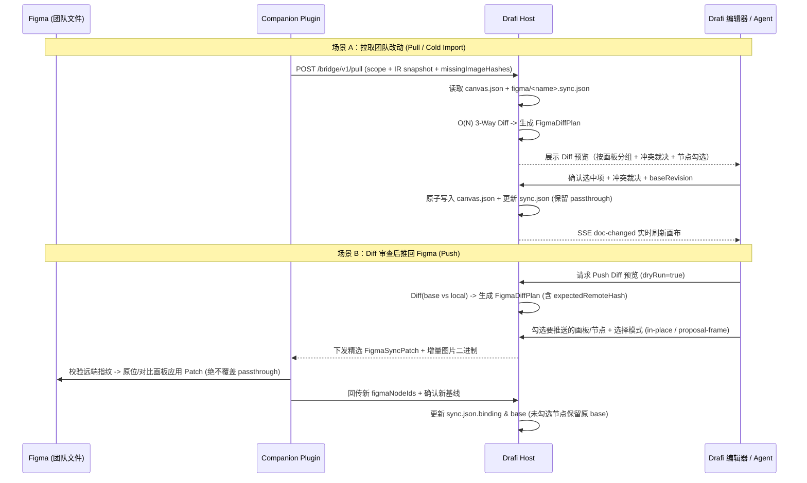

# Drafi × Figma 生态融合架构设计（v2 Architecture）

> **定位一句话**：**Figma 是团队的在线协作与评审入口，Drafi 是本地 AI 原生设计与改稿工作台。**  
> 我们不照抄 Figma 的重型功能，而是以 **100% 免费可用、高兼容性存储、快捷无损互换、双向原位同步、保留大画布性能** 为核心原则，构建一套轻巧稳健的双向生态桥。

---

## 1. 设计目标与硬约束

| 维度 | 约束与目标 |
| --- | --- |
| **成本门槛** | **完全免费**：不依赖 Figma 付费席位、Dev Mode 或 Enterprise-only REST API（如 Variables REST API）。个人免费版 / Starter 账号即可跑通全链路。 |
| **分工定位** | **不照抄 Figma**：Figma 负责多人实时协作、团队评审/评论、品牌主组件库、复杂矢量与原型分享；Drafi 负责 AI 生成与改稿、选区对话、TODO 驱动批改、`canvas_audit` 审计、`canvas_snapshot` 视觉自检及交互连线导航。 |
| **同步方向** | **真正双向同步**：支持 Figma 已有稿件冷导入（Figma-First）、增量三方拉取（Pull），以及 Drafi 改动原位回写（Push）到团队现有 Figma 文件，**不破坏原 Figma 文件链接、评论和版本历史**。 |
| **存储模型** | **兼容性优先 + 快捷无损互换**：工作文件保持精简开放的 `dsh.canvas@1`；Figma 绑定与无法直接编辑的原生属性走侧车元数据 + 透传保真（Passthrough）；便携归档支持毫秒级无损互换。 |
| **性能基线** | **完整保留现有大画布优化**：`SceneTiles` 空间瓦片渲染、`ViewportMemory` 视口记忆、视口独立订阅防重绘、交互面板懒加载，同时确保 2,000+ 图层同步仍保持亚秒级 diff 与按需资源传输。 |
| **明确暂不做** | Token 化 CSS 输出、Dev Mode / Code Connect、钢笔/矢量网编辑器、Figma 多人实时光标、原型运行态引擎。 |

---

## 2. 总体系统架构

核心思想是 **「一核、一 IR、双通道、一侧车」**：

- **一核**：`src/shared/` 作为唯一真源层（规范化、纯变更操作、布局引擎、同步 IR、三方合并引擎），Host 与 Client 共用。
- **一 IR**：定义统一的轻量中间表示 `dsh.figma.ir@1`，所有外部通道都只负责 `Transport ↔ IR`，与合并逻辑彻底解耦。
- **双通道（分层互补，全部免费）**：
  - **主通道 — Drafi Companion Figma Plugin**：基于 Figma 官方 `figma.*` Plugin API（免费账号可用，无 REST 限流，原生读写 Auto-Layout / 组件 / 样式 / 图片 / `pluginData`），负责**高保真双向拉取与原位 Patch 回写**。
  - **兜底通道 — 零插件通道**：`.fig` 本地副本解析（`fig-reader`）+ 剪贴板互粘（`⌘C/⌘V` Figma HTML/Kiwi & SVG）+ 免费 REST API（评论、版本、按需节点冷拉取），满足未装插件或离线场景。
- **一侧车**：`<name>.canvas.json` 永远保持干净的 `dsh.canvas@1`，同步基线、ID 映射、Figma 原生透传属性与外部评论全部收敛到侧车文件 `.dsh-canvas/figma/<name>.sync.json`。

```mermaid
flowchart TB
  subgraph TeamHub["Figma（团队协作与交互入口 · 免费可用）"]
    FDoc["团队 Figma 文件<br/>(页面 / Auto-Layout / 组件 / 原型 / 评论)"]
    FPlugin["Drafi Companion Plugin<br/>(官方 Plugin API · pluginData 绑定)"]
    FFile["本地副本 .fig / 剪贴板 ⌘C"]
    FRest["Figma REST API (免费)<br/>/comments · /versions · /nodes"]
  end

  subgraph DrafiHost["Drafi Host (DSH Node 进程)"]
    Bridge["Local Pairing Bridge<br/>(回环 + 一次性配对 Token / JSON 互换)"]
    Adapters["Transport Adapters<br/>Plugin · .fig Kiwi · Clipboard · REST"]
    Reconciler["3-Way Reconciler & Patcher<br/>(基于 dsh.figma.ir@1)"]
    SharedEngine["src/shared/<br/>format · ops · resolve · layout · audit · interactions"]
    Tools["DSH Agent Tools<br/>canvas_read/edit/audit/snapshot/figma"]
  end

  subgraph Storage["本地工作区 .dsh-canvas/"]
    CanvasJson["<name>.canvas.json<br/>(精简 dsh.canvas@1 单一真源)"]
    SyncJson["figma/<name>.sync.json<br/>(binding · 3-way base · passthrough · comments)"]
    Blobs["assets/ · fonts/ · figma-snapshots/"]
    Bundle[".dshfig 便携无损包 (ZIP)"]
  end

  subgraph DrafiUI["Drafi Web UI (DSH 右侧边栏)"]
    Editor["CanvasView + SceneTiles (2000+ 层)<br/>ViewportMemory + 独立视口订阅"]
    Collab["选区入对话 · AI TODO 评论面板<br/>Figma 同步/冲突预览弹窗 · 交互连线聚焦"]
  end

  FDoc <--> FPlugin
  FPlugin <-->|主通道：无损双向同步| Bridge
  FFile -->|兜底通道：离线导入/粘贴| Adapters
  FRest <-->|团队评论与版本同步| Adapters
  Bridge <--> Adapters
  Adapters <-->|dsh.figma.ir@1| Reconciler
  Reconciler <--> SharedEngine
  Tools <--> SharedEngine
  SharedEngine <--> CanvasJson
  Reconciler <--> SyncJson
  Reconciler <--> Blobs
  CanvasJson -.-> Bundle
  SyncJson -.-> Bundle
  Blobs -.-> Bundle
  DrafiHost <-->|SSE + Loopback API| DrafiUI
```

---

## 3. 存储模型设计：兼容性优先 + 快捷无损互换

### 3.1 为什么放弃「单文件双份存储 (`dsh.canvas.figma@1`)」？
原根目录原型在 `<name>.canvas.json` 中同时存了一份 Figma 树 `document` 和一份 `dsh.nodes` 扩展表，存在三个长期隐患：
1. **体积膨胀 3–6×**：8 MiB 上限被迫涨到 48 MiB，拖慢读写、序列化与 SSE 同步；
2. **双源脱节风险**：Drafi 承诺 `.canvas.json` 可被普通文件工具和代码 Agent 直接编辑，单文件双份结构一旦只改一边就会解码报错或状态漂移；
3. **Git Diff 噪音极大**：每次微调坐标都会同时污染 `relativeTransform`、`dsh.nodes` 和 `baseline`。

### 3.2 新存储布局（单一真源 + 侧车 + 内容寻址）

```text
<workspace>/.dsh-canvas/
├── main.canvas.json                # 永远是干净、标准的 dsh.canvas@1（单一事实源）
├── <name>.canvas.json
├── assets/<sha256-24>.<ext>        # 内容寻址图片（去重、不可变）
├── fonts/<sha256-24>.<ext>         # 内容寻址字体
├── figma/
│   └── <name>.sync.json            # 侧车文件：Figma 绑定、3-way 基线、透传属性、远端评论
├── figma-snapshots/
│   └── <sha256>.fig                # （可选）通过 .fig 兜底通道导入时的原始只读快照
└── exports/
    ├── <name>.dshfig               # 统一便携无损包（ZIP）
    └── ...
```

### 3.3 `<name>.sync.json` 核心结构（`dsh.figma.sync@1`）

```ts
export interface FigmaSyncSidecar {
  format: 'dsh.figma.sync'
  version: 1
  canvasName: string
  canvasDocId: string

  /**
   * 三层解耦的永久业务身份（吸收自 2,331 节点真实竞品画布审计）：
   * 解决旧版 `pageRef` 直接挂在可删除物理节点上的断链缺陷：
   * 删掉源摆放（如 G31 的 start-0）后，其余摆放仍归属原 logicalPageId，分支不丢失。
   */
  identities: {
    logicalPages: Record<string, {
      id: string                    // 永久逻辑页面 ID（脱离可删除的物理节点）
      name: string
      screenshotHash?: string
      evidence?: Record<string, unknown>
    }>
    placements: Record<string, {
      placementId: string           // 对应画布物理节点 dshId
      logicalPageId: string         // 所属逻辑页面（兼容迁移旧 pageRef）
    }>
    interactions: Record<string, {
      interactionId: string         // 永久业务动作 ID（改文案/换列/重排均不变）
      fromPlacementId: string
      toPlacementId: string
      event: string
      wireIds: string[]             // 派生可见箭头节点
      labelIds: string[]            // 显式事件标签节点（迁移旧 *-arrow/*-event）
      evidence?: Record<string, unknown> // verifiedIn 等实测证据
      evidenceStatus?: 'verified' | 'needs-recheck' // 远端重连新目标时旧证据进历史、新边标待复核
    }>
  }

  /** 绑定目标：支持整文件、单页或指定 Frame 子树 */
  binding: {
    bindingId: string               // 绑定实例唯一 ID（复制/分叉文件须重新配对，不沿用旧权限/评论）
    fileKey: string
    fileName?: string
    fileUrl?: string
    scope:
      | { kind: 'document' }
      | { kind: 'pages'; pageIds: string[] }
      | { kind: 'subtrees'; figmaRootIds: string[] }
    transport: 'plugin' | 'rest' | 'fig-file'
    lastSyncedAt: string
    lastCanvasRevision: string
    lastRemoteVersion?: string      // Figma version id 或 .fig sha256
    /** 双向 ID 映射（以 dshId 为 key，避免污染 Figma 图层名） */
    pages: Record<string, string>       // dshPageId -> figmaPageId
    nodes: Record<string, string>       // dshNodeId -> figmaNodeId
    styles: Record<string, string>      // dshStyleId -> figmaStyleId/key
    components: Record<string, string>  // dshComponentId -> figmaComponentId/key
    imageHashes: Record<string, string> // figmaImageHash -> "assets/<hash>.<ext>"
  }

  /**
   * 双基线三方合并公共祖先（O(N) 快速 diff + 0 写入幂等保证）：
   * - localBase：上次同步确认时的 Drafi 本地规范值
   * - remoteProjectedBase：上次从 Figma 实际回读的投影值（消除字体回退如
   *   Noto Sans SC SemiBold -> Medium 及 0.01 浮点精度导致的假 Diff）
   */
  base: {
    localNodes: Record<string, SyncedNodeBase>
    remoteProjectedNodes: Record<string, SyncedNodeBase>
    order: Record<string, string[]> // parentDshId -> ordered child dshIds
  }

  /**
   * 无损透传表（核心）：
   * 保存 Drafi 不编辑但 Figma 拥有的原生属性（原型连线 reactions、混合模式、
   * constraints、booleanOperation、vectorNetwork、boundVariables、富文本段等）。
   * Drafi 改文字/布局/颜色时绝不覆盖这些字段；原位回写 Figma 时保留原值。
   */
  passthrough: Record<string, FigmaOpaqueProps>

  /** 团队交互入口元数据：从 Figma 同步的评论与版本（含孤儿评论待定位与防回声映射） */
  remoteComments?: {
    syncedAt: string
    items: Array<SyncedFigmaComment & {
      anchorState: 'attached' | 'unanchored-needs-relocate' // 节点被删时不阻断写入，保留原坐标与线程
      localCommentId?: string                                // 双端 ID 映射，避免回复回声
    }>
  }
  nativeSnapshot?: {
    file: string
    sha256: string
    schemaVersion: number
  }
}
```

### 3.4 快捷无损互换机制
1. **彻底废弃 Sketch 中转链路**：不引入 `.sketch` 导出，不在 Figma 图层名追加 `[dsh:...]` 污染标记。历史实验格式 `dsh.canvas.figma@1` 若存在于旧工作区，Host 仅提供只读透明迁移拆包为 `dsh.canvas@1` + 侧车。
2. **对外统一便携包 `.dshfig`**：
   - 采用 ZIP 容器（`fflate`）：`manifest.json` + `canvas.json` + 可选 `figma.sync.json` + `objects/<sha256>`（图片/字体采用 `level: 0` 零压缩拷贝，导出/导入 200ms 内完成）。
   - 同时保留旧 `.drafi.json` 导入兼容，不再维护两套割裂的打包逻辑。
3. **跨工具极速互换（Stage 1 优先落地）**：
   - **剪贴板级（秒级双向）**：
     - **Figma `⌘C` → Drafi `⌘V`**：浏览器拦截画布 `paste` 事件，识别剪贴板 `text/html` 中的 `<!--(figmeta)...-->` + `<!--(figma)...-->`（Figma 原生 Kiwi 剪贴板格式），交由 Host 路由 `POST /dsh-canvas/api/figma/paste` 解码（保持 Client 零重依赖、零 `node:*`），自动把内嵌图片落盘 `.dsh-canvas/assets/` 并返回规范 `dsh.canvas@1` 节点与 `passthrough` 元数据，直接插在当前视口/光标处；若剪贴板为 SVG（`Copy as SVG`）则自动走增强 SVG 导入兜底。
     - **Drafi `⌘C` → Figma `⌘V`**：复制选中图层时，同步把精简 SVG 写入剪贴板（不影响 Drafi 内部剪贴板状态），方便无插件时快速贴回 Figma。
   - **插件级（一键同步）**：Plugin 直接向 Drafi Host 推送/拉取 `dsh.figma.ir@1` 增量包，仅传输发生变化的节点与本地缺失的图片 hash。

---

## 4. 统一同步中间层（`dsh.figma.ir@1`）与双向合并协议

### 4.1 统一 IR 层：解耦所有传输通道
所有外部输入/输出都统一归一化为 `dsh.figma.ir@1`，避免每个通道重复写颜色转换、矩阵计算和冲突判断：

- **统一颜色规范**：集中实现 `hexToFigmaRgba` / `figmaRgbaToHex`，**彻底修复 8 位 `#RRGGBBAA` 透明色与 `opacity` 叠加问题**（以及模糊效果 `radius` 字段映射）。
- **统一几何规范**：导出前先在 `src/shared/scene/` 跑一遍 `buildScene + layoutScene`，保证 Auto-Layout 子节点拥有精确的绝对/相对坐标与尺寸，解决原 `sketch.ts` 子节点堆叠 `(0, 0)` 的问题。
- **共享同一套 `Reconciler`**：
  - `PluginAdapter` (`figma.*` SceneNode ↔ IR)
  - `FigFileAdapter` (`fig-reader.ts` Kiwi ↔ IR，升级支持**冷导入**新文件 + 增量拉取)
  - `ClipboardAdapter` (Figma clipboard HTML/Kiwi / SVG → IR)
  - `RestAdapter` (Figma REST `/nodes`、`/images`、`/comments`、`/versions` ↔ IR)

### 4.2 双向同步能力矩阵（覆盖 80/20 高频设计字段）

| 类别 | Drafi ↔ Figma 双向同步 | 透传保真（不在 Drafi 强行实现 UI） |
| --- | --- | --- |
| **结构与身份** | 多页 (`CANVAS`)、新增/删除/重命名/层级移动/同级排序、无侵入 `pluginData('dshId')` | 未知/复杂节点类型（如 `BOOLEAN_OPERATION`、`SECTION`、`STICKY`）保留占位或光栅回退预览 |
| **几何与布局** | `x/y/w/h/rotation`、Auto-Layout（方向、gap、padding、主/交叉轴对齐、`fixed/hug/fill`、**隐藏节点不占位**、`ABSOLUTE` 定位、`wrap`） | 非 Auto-Layout `constraints`（透传保留）、Grid / MinMax（透传保留，后续按需加） |
| **外观** | 多层 `solid` / `linear-gradient` / `radial-gradient` / `image`（SHA-256 去重）、描边、圆角（支持独立四角 `cornerRadii`）、透明度、阴影与模糊 | BlendMode、Mask、Image Filters、复杂渐变矩阵、Bound Variables |
| **文本** | 文本内容、字体族/字重/字号/行高/字距、水平/垂直对齐、自动高度 | 混排富文本 `styledTextSegments`（文本未改时完整透传；文本改动时显式提示降级） |
| **组件与样式** | `COMPONENT` / `COMPONENT_SET` / `INSTANCE` 及文本/填充/显隐覆盖；局部 Fill/Text/Effect 样式 | 远端 Team Library 组件引用（保持实例绑定，不破坏库链接） |
| **交互与团队协作** | Figma 评论 ↔ Drafi 评论/TODO 联动；Drafi `interaction` 线与 `pageRef` 本地保留不丢失 | Figma Prototyping `reactions` 完整透传保留 |

### 4.3 类 Git Diff 双向审查与合并机制（核心安全阀）

无论是 **Pull（Figma → Drafi）** 还是 **Push（Drafi → Figma）**，都不做盲目覆盖，而是先生成一份结构化、可勾选、可校验的 **`FigmaDiffPlan`**（类似 `git diff` + PR Review）：

```ts
export type DiffKind = 'added' | 'modified' | 'moved' | 'deleted'
export type ConflictResolution = 'keep-drafi' | 'take-figma' | 'skip'
export type PushApplyMode = 'in-place' | 'proposal-frame'

export interface FieldChange {
  field: string                 // e.g. 'text' | 'fills' | 'x' | 'layout.gap' | 'cornerRadii'
  before: unknown
  after: unknown
  category: 'geometry' | 'layout' | 'content' | 'style' | 'structure'
}

export interface NodeDiffEntry {
  dshId: string
  figmaNodeId?: string
  nodeName: string
  nodeType: string
  pageId: string
  rootFrameId?: string          // 按顶层画板/Screen 分组展示
  kind: DiffKind
  fields: FieldChange[]
  passthroughPreserved: string[] // 明确提示哪些 Figma 原生属性将被无损保留
  expectedRemoteHash?: string   // 乐观锁：远端节点在审批期间若被团队改动，Push 自动拒绝并提示重拉
  selected: boolean             // 支持按画板/节点粒度勾选（Hunk Staging）
}

export interface DiffConflict {
  dshId: string
  figmaNodeId?: string
  nodeName: string
  field: string
  reason: 'both-modified' | 'deleted-remotely' | 'deleted-locally' | 'reparented' | 'type-changed'
  baseValue?: unknown
  localValue?: unknown
  remoteValue?: unknown
  resolution?: ConflictResolution
}

export interface FigmaDiffPlan {
  planId: string
  direction: 'pull' | 'push'
  canvasName: string
  baseCanvasRevision: string
  fileKey: string
  summary: {
    added: number
    modified: number
    moved: number
    deleted: number
    conflicts: number
    assetsToTransfer: number
  }
  entries: NodeDiffEntry[]
  conflicts: DiffConflict[]
  notices: string[]             // 例如：混排文本降级提示、未知 Figma 节点占位提示
}
```

**Diff 工作流保障**：
1. **双基线消噪 + 严格幂等**：以 `localBase` 对比本地当前值、以 `remoteProjectedBase` 对比远端当前值（位置/尺寸容差 `0.01px`、角度 `0.01°`，过滤字体替换噪音），确保 **重复 Pull / Push 产生 0 变更、0 写入**。
2. **完整读取删除安全阀**：`FigmaDiffPlan` 显式标记 `readCompleteness: 'complete' | 'partial'`；若发生缺页、超时或权限受限（`partial`），**严禁生成 `deleted` Diff 项**，防止误删远端或本地图层。
3. **孤儿评论「待定位」与业务证据联动**：
   - 删除被评论锚定的节点时，不再阻塞文档校验，而是将关联评论转入 `unanchored-needs-relocate` 状态并保留原坐标和完整回复线程；
   - 在任一端修改共享交互事件文案时，自动联动 `interaction.event` 与所有受管 `labelId`；若远端将原型/连线重连至新目标，保留历史实测证据并将新边标为 `needs-recheck`。
4. **按画板分组 + 选择性合入（Selective Staging）**：在 UI 弹窗和 Agent 工具（`dryRun: true`）中统一呈现「页面 → 画板 → 图层 → 字段（旧值 → 新值）」，支持按画板/节点粒度勾选参与本次同步，未勾选项保留原 `base` 基线不被下次同步覆盖。
5. **冲突显式裁决 + Push 双交付模式（带乐观锁）**：
   - 冲突逐条提供 `keep-drafi` / `take-figma` / `skip` 裁决，未裁决前禁止提交；
   - **`in-place`（Diff 确认后原位更新）**：逐项校验 `expectedRemoteHash`，只写入变动字段，保留所有 `passthrough` 原生属性，维持原 Figma URL、评论与版本历史；
   - **`proposal-frame`（AI 方案对比画板）**：在团队原画板旁克隆 `<原画板名> [Drafi Diff]` 画板应用改动，供团队 A/B 对比后再合入。
6. **Diff 变更摘要回执**：Push 完成后更新 `figma/<name>.sync.json` 双基线，并支持一键生成变更摘要（可选通过免费 REST API 发到 Figma 评论区告知团队改了什么）。

### 4.5 黄金验收基准（复用真实业务数据集）
1. **微基准（G31 3+1+1 → G42 单文件往返）**：
   - 删除 `start-0` 源摆放后，其余两份关联摆放仍归属原 `logicalPageId`，分支保持 8 条不丢失；
   - 两端分别移动 `start-1` 与 `G42`、同时修改事件文案 `点 Video Quality → 点视频画质`，三方合并全部保留且保留 `verifiedIn` 证据；
   - 删节点时关联评论保留坐标进入待定位态；重复同步写入严格为 **0**。
2. **压测基准（多画板全量设计稿）**：
   - 使用大规模业务画布数据集（**5 画板、2,331 节点、351 条交互连线、507 处摆放、251 张原图 / 54.8 MiB**），验收：瓦片帧率不退化、251 张原图逐张 SHA-256 零损耗、`.dshfig` 毫秒级互换、2,331 节点三方 Diff 亚秒级完成。



### 4.4 免费通道的安全连接设计（Plugin ↔ Local Host）
现有 `src/host/main.ts` 严格限制了 loopback 同源校验，这是很好的安全边界，**不要放宽已有 `/dsh-canvas/api/*` 路由**。对 Figma Plugin 新增一条独立、最小权限的配对通道：
1. **模式一（一键本地直连 — 最佳体验）**：
   - 用户在 Drafi 弹窗点击「生成配对码」，Host 在内存中生成一个短期随机 Bearer Token（仅绑定回环 `127.0.0.1`），只开放专用路由 `/dsh-canvas/bridge/v1/*`（显式允许 Figma Plugin iframe CORS，强制校验 `Authorization: Bearer <token>` + 仅限当前会话工作区）。
   - Plugin UI 记住配对码后即可一键「拉取到 Drafi / 推回 Figma」，全过程本地回环，**零云端中转、零数据出境、零费用**。
2. **模式二（零网络文件互换 — 严格内网/受限浏览器兜底）**：
   - 如果环境禁用浏览器访问 `localhost`，Plugin UI 直接支持导出/拖入 `.dshfig` 或 `.dshpatch.json`，走完全相同的 `dsh.figma.ir@1` 引擎！

---

## 5. 「Figma 团队入口 × Drafi AI 工作台」核心协作流与快速配置

### 5.1 核心协作闭环（团队评审 → AI 改稿 → 原位交付）

针对「**Figma 作为团队交互入口**」这一定位，我们不做 Dev Mode / Token CSS，而是把 **团队评审 → AI 改稿 → 视觉验证 → 原位交付** 打通成杀手级闭环：

1. **入口一：Figma URL / 选区一键进 Drafi**
   - 团队在群里或 Figma 发来一个链接 `figma.com/design/<key>/...?node-id=12-34`，或者设计师在 Figma 插件里选中几个界面点「发给 Drafi」。
   - Drafi 自动拉取对应画板与图片，建立 `sync.json` 绑定，无需导出 Sketch，也不污染 Figma 图层名。
2. **入口二：Figma 评论直通 AI TODO 改稿流**
   - 团队在 Figma 留下的评审意见，通过免费 REST API（`GET /v1/files/:key/comments`）拉取并按 `node_id` 自动锚定到 Drafi 画布节点。
   - 在 Drafi 评论面板以「来自 Figma」标签展示，用户可一键转为 TODO（衔接 `docs/ai-modification-interaction.md`），交给 AI 逐条修改，并用 `canvas_audit` + `canvas_snapshot` 自检。
3. **出口：原位 Push 回团队 Figma 文件 + 可选回复评论**
   - 修改满意后一键 Push：通过 Plugin 原位更新原 Figma 文件中的对应画板（或新建对比方案 Frame 供团队 A/B 评审，**不破坏原稿**）。
   - 可选调用 `POST /v1/files/:key/comments` 在 Figma 原评论下回复改动摘要，团队成员在 Figma 里直接看到结果，形成完整闭环。

### 5.2 零摩擦快速接入：`canvas-figma-setup` Skill 与安全凭证层

手动找 Figma 入口、选 Scopes、复制 PAT 并写入 Keychain 门槛过高，且直接粘贴到对话框存在明文泄露风险。我们在 `dsh-canvas` 中内置第二个运行时 Skill **`canvas-figma-setup`**（通过 `src/host/skills.ts` 与 `canvas-ui-design` 一并注册，支持自然语言「帮我配一下 Figma」或 `/canvas-figma-setup` 触发），配合 Host 安全凭证层把接入压到 **30 秒内且全程零明文进聊天上下文**：

1. **按需分档，不强迫一上来就配 Token**：
   - **L0 免配置即用**：Figma `⌘C` → Drafi `⌘V` 剪贴板直粘、`.fig` 本地文件导入 → **0 Token、0 插件**；
   - **L1 双向画板同步**：Drafi Companion Plugin（本地回环一次性配对码）→ **0 Token**；
   - **L2 云端协作增强**：URL 冷导入、团队评论拉取/回写、版本历史 → 才需要 Figma API Token。
2. **`canvas-figma-setup` Skill 四步极速引导**：
   - **① 自动体检（`canvas_figma({ action: 'setup_status' })`）**：一次探测本机 Token 是否已存在并用 `GET /v1/me` 验活（仅返回脱敏账号、权限模式与过期倒计时，绝不回显明文），同时检测 Figma Desktop 与 Companion Plugin 状态；
   - **② 单题分流**：通过 `ask_user_question` 确认用户所需档位（仅插件免 Token / 只读 REST / 含评论回写 REST）；
   - **③ Token 极速安全获取（全程不经 LLM 上下文）**：
     - **默认路径（PAT 引导 + 零泄露盲存，零外部服务依赖）**：
       1. 自动打开用户默认浏览器的 `https://www.figma.com/settings`（复用已有登录态，绝不触碰账号密码或绕过 2FA），并给出精确到勾选项的最小权限清单（只读：`File content: Read-only` + `Comments: Read-only`；完整协作再勾 `Comments: Write`；过期选 `90 days`）；
       2. **双安全写入通道（二选一，严禁贴进对话框）**：
          - **通道 A（首选 · Drafi UI 密码框）**：打开 Drafi 侧边栏「Figma 配置」弹窗，用户在 `type="password"` 框内粘贴并点「验证并保存」→ 走严格回环同源 `POST /dsh-canvas/api/figma/auth/token` → Host 立即调 `/v1/me` 验活落盘；
          - **通道 B（无 UI / 终端兜底 · 剪贴板盲读脚本）**：用户在 Figma 点完「Copy this token」后确认执行内置脚本 `scripts/figma-setup.mjs --from-clipboard`（校验 `^figd_[A-Za-z0-9_-]{20,200}$` → 写入系统凭证库 → **立即清空系统剪贴板** → 仅输出脱敏状态 JSON 给 Agent；也支持无回显终端输入）；
     - **进阶路径（统一凭证层预留 · OAuth 2.0 一键授权）**：`credentials.ts` 抽象统一凭证结构 `{ kind: 'pat' | 'oauth', accessToken, refreshToken?, expiresAt?, scopeMode }`；若后续配置了团队或官方 Figma OAuth App（本地回环回调 `/dsh-canvas/api/figma/oauth/callback`），可直接点浏览器「Allow access」自动落盘并支持 `refresh_token` 自动续期，彻底免去手动复制与 90 天过期。
   - **④ Companion Plugin 一键导入与端到端验活**：
     - 自动复制 `figma-plugin/manifest.json` 绝对路径并给出 3 步指引（Figma Desktop → Plugins → Development → Import plugin from manifest... → `⌘⇧G` 粘贴），同时签发一次性本地配对码；
     - 若用户贴出任意 Figma URL，立即执行一次轻量 `depth=1` / `/comments` 探针确认实际文件可读、评论权限生效，并记录 90 天到期前 7 天的续期提醒。
3. **跨平台安全凭证库（`src/host/figma/credentials.ts`）**：
   - 读取优先级：`DSH_FIGMA_TOKEN` 环境变量 → macOS Keychain（`service: 'dsh-canvas.figma'`，向下兼容读取旧 `dsh-canvas.figma.personal` / `readonly`）→ Linux `secret-tool` / 受保护本地文件 `~/.dsh/credentials/dsh-canvas-figma.json`（严格 `0600` 权限）；
   - 仅限回环同源的管理路由：`GET/POST/DELETE /dsh-canvas/api/figma/auth/token` 与 `GET /dsh-canvas/api/figma/auth/status`，任何错误日志与工具返回值均强制脱敏。

---

## 6. 数据模型最小增量对齐 & 性能架构保留

### 6.1 `dsh.canvas@1` 最小 80/20 增量扩展（全部向后兼容）
不搞破坏性 `v2` 重写，仅在 `src/shared/format.ts` 与 `src/shared/scene/` 做 4 项小而关键的对齐：
1. **Auto-Layout 隐藏子节点行为对齐 Figma**：`visible === false` 的子节点退出流式排布占位（加文档级兼容开关，旧文档不受影响）。
2. **Auto-Layout 补齐两项高频属性**：子项 `layoutPositioning?: 'auto' | 'absolute'` 与容器 `layout.wrap?: boolean`。
3. **独立四角圆角**：允许可选 `cornerRadii?: [number, number, number, number]`（与现有 `cornerRadius` 共存）。
4. **多页 UI 切换**：模型已支持 `pages[]`，仅在左侧图层面板顶部加轻量的 Page 下拉/列表切换器。

### 6.2 完整保留并强化性能架构
将原根目录中已验证的大画布优化完整迁移并固化到新架构基线中：

| 模块 | 保留的核心优化 | 与 Figma 生态结合的增强 |
| --- | --- | --- |
| **`src/shared/scene/`（从 `client/editor` 下沉）** | `resolve.ts` + `layout.ts` 纯逻辑零 DOM 依赖 | Host 导出/Push、Headless `canvas_audit` 与浏览器渲染共享同一布局计算结果 |
| **`src/client/editor/scene-tiles.ts`** | 1024px 空间瓦片索引 + 祖先路径恢复 + 兄弟序保序（2,000+ 层流畅平移缩放） | 同步导入大型 Figma 多屏流程图时，直接走瓦片挂载，不卡顿主线程 |
| **`src/client/editor/viewport-memory.ts`** | 按 `workspace + doc + page` 节流持久化视口，挂载前恢复 | 切换多个从 Figma 导入的 Page 时，记住每页独立视口位置 |
| **独立视口订阅** | `subscribeViewport` + `ZoomPercentage` + `React.memo(CanvasView)` 隔离面板重绘 | 保持不变 |
| **交互连线与 `pageRef`** | `interactions.ts`、`interaction-focus.ts`、`InteractionPanel.tsx`（滚动邻近懒加载缩略图） | 同步 Figma 时完整保留 `pageRef`、`interaction.id` 与事件标签联动 |
| **大画布同步性能** | — | ① 支持按 Page / 选中 Frame 局部同步（不每次整文件全量拉取）；② 图片 SHA-256 差量传输，已存在图片零重复下载；③ 3-way diff 按节点字段哈希 O(N) 对比 |

---

## 7. 目标目录与模块边界

保持 `AGENTS.md` 的严格分层（Client 不碰 `node:*` / `host`；Host 不碰 DOM / React；共享逻辑归 `src/shared/`）：

```text
dsh-canvas/
├── src/
│   ├── shared/
│   │   ├── format.ts                # dsh.canvas@1 规范化与最小增量扩展
│   │   ├── ops.ts                   # 原子变更操作
│   │   ├── interactions.ts          # 交互连线 & pageRef 索引（迁入基线）
│   │   ├── scene/
│   │   │   ├── resolve.ts           # 从 client 下沉：文档 -> 渲染树
│   │   │   └── layout.ts            # 从 client 下沉：Auto-Layout 引擎（支持 headless）
│   │   └── figma/
│   │       ├── ir.ts                # dsh.figma.ir@1 规范、颜色/矩阵/几何纯转换
│   │       ├── sync-types.ts        # dsh.figma.sync@1 侧车契约
│   │       ├── reconcile.ts         # 统一 O(N) 三方合并 & 冲突模型
│   │       └── patch.ts             # Drafi -> FigmaSyncPatch 生成器
│   ├── host/
│   │   ├── main.ts                  # Host 路由 + Agent 工具 + /bridge/v1 配对路由 + /api/figma/auth/*
│   │   ├── skills.ts                # 注册运行时 skills：canvas-ui-design + canvas-figma-setup
│   │   ├── interaction-tools.ts     # canvas_interaction_view 通道（迁入基线）
│   │   └── figma/
│   │       ├── credentials.ts       # 跨平台安全凭证库（Keychain / 0600 文件 / PAT & 预留 OAuth）
│   │       ├── sidecar.ts           # figma/<name>.sync.json 原子读写与旧 archive 透明兼容
│   │       ├── bridge.ts            # Plugin 配对码管理与增量拉取/回写协调器
│   │       ├── clipboard.ts         # Figma 剪贴板 HTML/Kiwi 解码 + 图片落盘 (POST /api/figma/paste)
│   │       ├── fig-adapter.ts       # 复用 fig-reader.ts：支持 .fig 冷导入 + 增量拉取
│   │       ├── rest-adapter.ts      # 免费 REST API：评论读写、版本、按 URL/Node 冷导入
│   │       └── bundle.ts            # 统一 .dshfig ZIP 便携无损包（兼容旧 .drafi.json）
│   └── client/
│       ├── editor/
│       │   ├── scene-tiles.ts       # 空间瓦片索引（迁入基线）
│       │   ├── viewport-memory.ts   # 视口记忆（迁入基线）
│       │   ├── clipboard-figma.ts   # 剪贴板粘贴 Figma Kiwi / SVG 解析入口
│       │   └── ...
│       └── ui/
│           ├── FigmaSyncDialog.tsx  # 绑定状态、安全 Token 密码框配置、URL 导入、Plugin 配对、冲突解决、导出 .dshfig
│           ├── PageSwitcher.tsx     # 轻量多页切换器
│           └── ...
├── figma-plugin/                    # 独立轻量 Figma Companion Plugin（免费本地加载 / 社区发布）
│   ├── manifest.json                # 声明仅访问本地回环或无网络文件互换
│   ├── code.ts                      # Figma 主线程：SceneNode <-> dsh.figma.ir@1 + pluginData 绑定 + 原位 Patch
│   └── ui.html / ui.ts              # 极简面板：配对连接、拉取选区/整页、应用 Drafi Patch、导入导出 .dshfig
├── scripts/
│   └── figma-setup.mjs              # CLI 剪贴板盲读/隐藏输入凭证写入脚本（防明文进聊天上下文）
└── skills/
    ├── canvas-ui-design/            # UI 设计主 Skill：纳入 Figma 拉取/评审评论/原位回写工作流
    └── canvas-figma-setup/          # 快速 Setup Skill：30 秒按需引导 Token 安全配置 + Plugin 一键接入 + 连通性验活
```

---

## 8. 已确认决策与分阶段落地计划

### 已拍板的关键决策
- ✅ **保留性能优化与交互连线，彻底不走 Sketch**：全量迁入原根目录的 `SceneTiles`、`ViewportMemory`、独立视口订阅、`interactions` / `pageRef` / `InteractionPanel` / `canvas_interaction_view`；废弃 `sketch.ts` / `sketch-format.ts` 及 `[dsh:...]` 图层名污染方案；复用并重构 `fig-reader.ts`、`rest.ts`、`bundle.ts`。
- ✅ **双向同步采用类 Git Diff 机制**：Pull 与 Push 均先产出可审查、可按节点/画板勾选、带乐观锁校验和冲突裁决的 `FigmaDiffPlan`，Push 支持 `in-place` 原位合入与 `proposal-frame` 对比画板两种交付模式。
- ✅ **剪贴板互粘纳入 Stage 1 优先落地**：Figma `⌘C` → Drafi `⌘V` 通过 `POST /dsh-canvas/api/figma/paste` 解码 Figma Kiwi/SVG 剪贴板并自动落盘图片，Drafi 复制支持写入 SVG 方便贴回 Figma。
- ✅ **聚焦免费生态与 AI 工作台**：不照抄 Figma 重编辑功能，暂不做 Token 化 CSS 与 Dev Mode。
- ✅ **零摩擦安全配置（`canvas-figma-setup` Skill）**：按 L0（剪贴板/`.fig` 免 Token）→ L1（Plugin 配对免 Token）→ L2（REST Token）按需分档；Token 获取采用「直达设置页 + 精确最小 Scope 清单 + UI 密码框 / 剪贴板盲读落盘 Keychain 并清空剪贴板」防明文进聊天上下文，并在凭证层预留 OAuth 2.0 本地回环一键授权扩展位。

### Stage 0：性能、交互连线与共享底座迁入
1. 从原根目录干净迁入非 Figma 的性能优化与交互连线改动：
   - `src/shared/interactions.ts`、`src/host/interaction-tools.ts`、`src/shared/format.ts`（`pageRef`、`interaction.id`、大文档预算）
   - `src/client/editor/scene-tiles.ts`、`src/client/editor/viewport-memory.ts`、`src/client/editor/interaction-navigation.ts`
   - `src/client/interaction-focus.ts`、`src/client/ui/InteractionPanel.tsx` 及 `CanvasPanel` / `CanvasView` / `Toolbar` / `store` 的视口隔离与交互聚焦集成
   - 对应全部单测（`scene-tiles`、`viewport-*`、`interactions`、`page-references`）
2. 将零 DOM 依赖的 `resolve.ts` 与 `layout.ts` 下沉到 `src/shared/scene/`（保留 `src/client/editor/` 薄 re-export 保持兼容），并通过 `pnpm check` 验证全绿。

### Stage 1：存储模型 + 统一 IR + Diff 引擎 + 剪贴板/离线/REST 导入 + 快速 Setup Skill
1. 落地 `src/shared/figma/`：
   - `ir.ts`（`dsh.figma.ir@1`、修复 8 位 `#RRGGBBAA` 与 blur `radius`、Auto-Layout 坐标对齐）
   - `sync-types.ts`（`dsh.figma.sync@1` 侧车模型、`FigmaDiffPlan`、`FigmaSyncPatch`）
   - `reconcile.ts`（O(N) 3-way diff、选择性合入、冲突裁决、`passthrough` 保护）
2. 落地 `src/host/figma/` 与快速配置链路：
   - `credentials.ts` + `/dsh-canvas/api/figma/auth/*` + `scripts/figma-setup.mjs`（跨平台 Keychain / `0600` 凭证管理、`/v1/me` 验活、剪贴板盲存并清空、预留 OAuth 接口）
   - `skills/canvas-figma-setup/SKILL.md` + `src/host/skills.ts` 多 Skill 注册（让用户一句话或 `/canvas-figma-setup` 即可 30 秒配好 Token 与后续 Plugin）
   - `sidecar.ts`（`figma/<name>.sync.json` 原子读写 + 兼容迁移旧 `dsh.canvas.figma@1`）
   - `fig-reader.ts` + `fig-adapter.ts`（升级支持 `.fig` **冷导入** + 增量 Pull Diff）
   - `clipboard.ts` + `POST /dsh-canvas/api/figma/paste`（**Figma `⌘C` → Drafi `⌘V` 剪贴板直粘**，含内嵌图片落盘与 SVG 兜底）
   - `rest-adapter.ts`（免费 REST API：按 URL/Node 冷导入 + 评论读写 + 版本历史）
   - `bundle.ts`（统一 `.dshfig` 无损 ZIP 归档，向下兼容 `.drafi.json`）
3. `dsh.canvas@1` 最小 80/20 对齐与 UI：
   - Auto-Layout 隐藏子节点不占位、`layoutPositioning: 'absolute'`、`cornerRadii`
   - 轻量多页切换 UI（`PageSwitcher`）+ 剪贴板粘贴监听（`clipboard-figma.ts`）+ Diff 审查与安全 Token 配置弹窗（`FigmaSyncDialog.tsx`）。

### Stage 2：免费 Figma Companion Plugin + 原位双向同步
1. 在 `figma-plugin/` 实现轻量伴生插件（免费本地开发加载 + 可发布社区）：
   - `code.ts`：`SceneNode ↔ dsh.figma.ir@1`、`setPluginData('dshId', id)` 无侵入绑定、带乐观锁校验的 `in-place` / `proposal-frame` Patch 执行器；
   - `ui.ts`：配对码直连 Drafi Host `/dsh-canvas/bridge/v1/*` + 无网络 `.dshfig`/`.dshpatch.json` 文件互换兜底。
2. 在 Host 实现 `bridge.ts`（一次性回环配对 Token、受控 CORS、SHA-256 差量图片交换、Pull/Push 完整 Diff 闭环）。

### Stage 3：团队评论 × AI TODO 闭环 & Skill / 文档收口
1. 将 `rest-adapter.ts` 拉取的 Figma 评审评论接入 Drafi 评论面板与 `docs/ai-modification-interaction.md` TODO 改稿流，支持改完后按 Diff 摘要回写 Figma 评论。
2. 同步更新 `canvas_figma` 工具、`skills/canvas-ui-design/SKILL.md`、`FORMAT.md`、`README.md`，运行完整 `pnpm check` 并重建提交产物。
